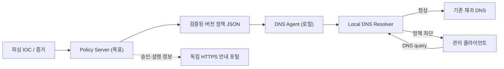

# 아키텍처 및 배포 경계

## 결정: 단일 저장소, 서비스별 독립 배포

단일 Git 저장소에서 `apps/policy-server/`, `apps/dns-agent/`, `apps/warning-portal/`를 관리합니다. 하나의 저장소라는 이유로 운영 권한·런타임·릴리스 파일을 결합하지 않습니다.

- **Control Plane**: IOC 출처·검토·승인·버전·만료·배포(추후 구현).
- **Data Plane**: 로컬 리졸버와 정책 적용기. 원격 서버 장애에도 기존 정상 서비스와 검증된 정책 유지 목표.
- **계약**: 공통 JSON 스키마/테스트 벡터. 내부 라이브러리나 관리자 권한을 양쪽 서비스가 공유하지 않음.
- **Portal**: 원래 피싱 HTTPS 호스트의 TLS 세션과 별도. DNS NXDOMAIN으로 포털 HTML을 자동 표시할 수 없음.

## 단계별 활성화

M1은 `policy-server` 없이도 로컬 JSON으로 실험할 수 있습니다. 실제 원격 서비스 연결은 M3의 확장 단계입니다. 중앙 DB·서명·AI 위험도·관리자 대시보드 도입은 별도 설계 승인과 테스트 전 **미구현**으로 분류합니다.

팀 논의에 따라 Unbound RPZ는 로컬 엔진의 **후보**입니다. 다른 리졸버로 바뀌더라도 `apps/dns-agent/resolver/`의 어댑터 계층에서 차이를 격리합니다.

[상세 기술 논의](https://app.notion.com/p/4025db6797f081e18de9cc1a2ca748f2) · [PoC 권고 지침](https://app.notion.com/p/4025db6797f081bcb766ec62d8025af7)
